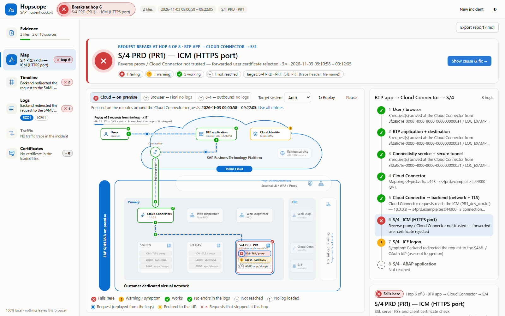

# Hopscope — SAP incident cockpit

Drop the logs of one SAP incident and see the hop where the request breaks, with the evidence lines and the fix.

A request from an SAP BTP application to SAP S/4HANA crosses up to eight hops — user, BTP application, Connectivity service, Cloud Connector, network and TLS, ICM, logon, ABAP. Each hop writes its own log, in its own format, often on a system another team owns. Hopscope reads them once, correlates them by time, connection ID and host, and draws the landscape as a map where the failing hop turns red.

## Features

- **One place for evidence**: SAP Cloud Connector logs and traffic trace, `dev_icm`, `dev_webdisp`, `dev_w*`, SM21, ST22 and SM59 exports, certificates (PSE, CRT, CER, PEM, P7B, keystores), HTTP access logs — files, folders or a `.zip`.
- **Landscape map**: SAP S/4HANA on-premise with SAP BTP; every hop of the request path gets a verdict, and the failing hop shows the cause, the evidence and the fix (for example the exact `icm/trusted_reverse_proxy_<n>` value).
- **Request replay**: the Cloud Connector requests of the logs are replayed in their real order; each packet stops at the hop where that request stopped.
- **Timeline, Logs, Traffic, Certificates**: correlated incidents across sources, a knowledge base of known log patterns, decoded HTTP traffic with HAR export, certificate chains verified by signature and trust checks against a PSE.
- **Checklist** of what to collect, with the SAP transaction for each source.

## Privacy

Everything runs in your browser. There is no server and no upload, no cookies, no analytics and no third-party scripts. See [privacy.html](privacy.html).

## Use it

- Online: open `index.html` on the published site.
- Offline: download this folder and open `index.html` in Microsoft Edge (or another Chromium-based browser). No installation, no build step.
- Try the built-in example (synthetic data): `index.html#example`.
- Documentation: [docs.html](docs.html). Self-test: [tests/selftest.html](tests/selftest.html).

## Disclaimer

Hopscope is an independent project, not affiliated with or endorsed by SAP SE. SAP and the SAP product names used here are trademarks of SAP SE. Provided as is, without warranty; verify findings before you change a system. See [disclaimer.html](disclaimer.html).

Made by [Nizar Fanany](https://www.linkedin.com/in/nizarfanany).
